<p align="center">
  
</p>

<h1 align="center">Taintgraph</h1>

<p align="center">
  <b>See how a supply-chain attack reaches your app, and who could poison it next.</b><br/>
  A FalkorDB graph agent for npm and PyPI lockfiles and AI-tool MCP configs.
</p>

<p align="center">
  <a href="https://github.com/kalash33/taintgraph/actions/workflows/ci.yml"></a>
  <a href="benchmark/RESULTS.md"></a>
  <a href="benchmark/RESULTS.md"></a>
  
  <a href="LICENSE"></a>
</p>

<p align="center">
  <b><a href="https://taintgraph.onrender.com">Live demo: taintgraph.onrender.com</a></b><br/>
  <sub>Free hosting: the first visit after a quiet spell can take up to a minute to wake up.</sub>
</p>

<p align="center">
  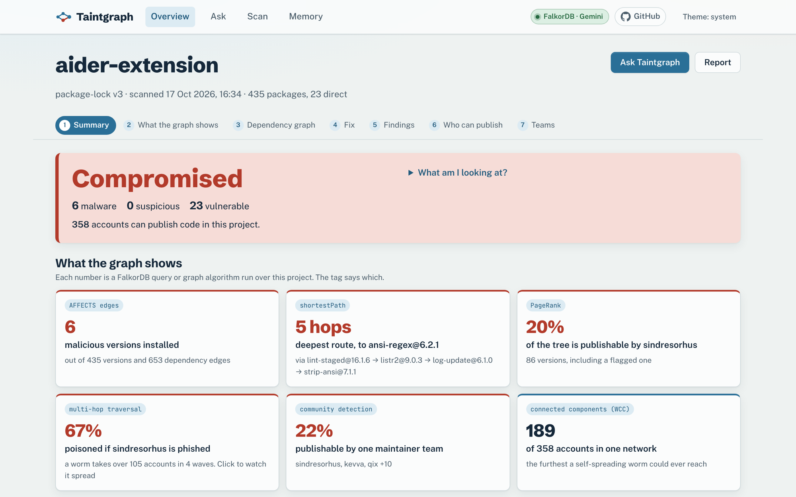
</p>

<p align="center">
  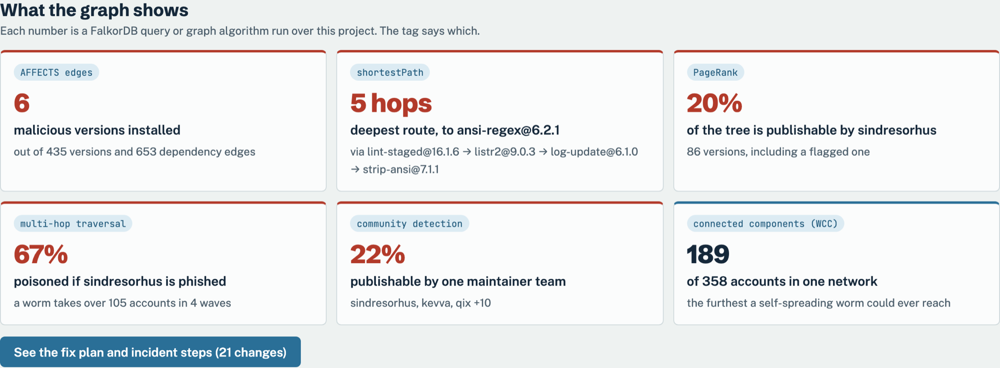
  <br/><sub>Every number on the dashboard is a FalkorDB query or graph algorithm, and its tag says which.</sub>
</p>

---

In September 2025, a phished maintainer pushed malware into `chalk`, `debug` and 16 other npm packages with billions of weekly downloads. A week later the Shai-Hulud worm began stealing npm tokens and republishing every package its victims maintained. In 2026, the same playbook hit TanStack and LiteLLM.

When that happens, a list of bad versions isn't enough. You need to know:

- **Am I hit, and how?** Which of my 400 dependencies pulls the bad version in, and through which chain?
- **Who else could do this to me?** Which single maintainer account can publish the biggest share of my tree?
- **What if it spreads?** If that account is phished, what does a worm reach in one wave, two, four?
- **Is my AI tooling exposed?** The MCP servers my coding assistant starts with `npx` every morning are a supply chain too.

Those are graph questions. Taintgraph loads the lockfile into FalkorDB: every installed version, who can publish it, who actually did, how each release changed from the last one, and every advisory that touches it. Then a set of agents answers them, remembers what you decided, and keeps watching.

## What it does

<table>
<tr>
<td width="50%" valign="top">

**Traces the route.** Each finding shows the exact chain from your project to the bad version, using only the dependency edges your own lockfile declared.

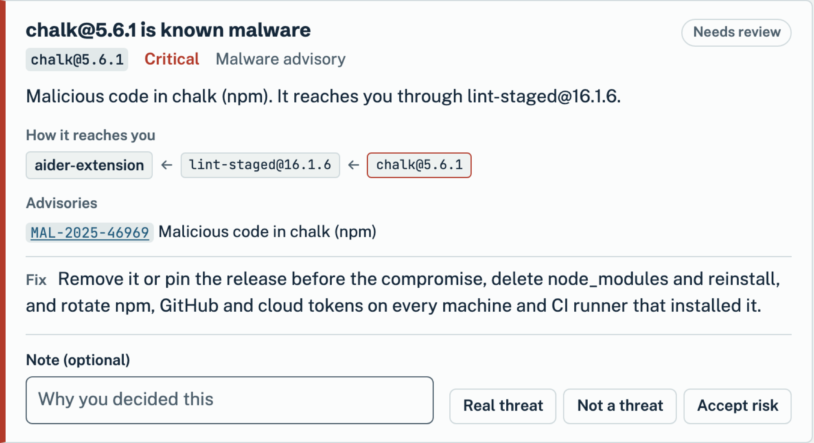

</td>
<td width="50%" valign="top">

**Ranks who can poison you, and simulates the worm.** Accounts are weighted by the PageRank of everything they can publish; community detection groups them into maintainer teams, and connected components show how far a worm could ever travel. Pick one and watch a Shai-Hulud style worm spread wave by wave.

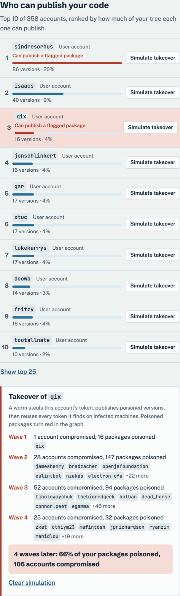

</td>
</tr>
<tr>
<td valign="top">

**Answers questions, and shows its work.** An Analyst agent uses fixed, read-only Cypher tools. Every step shows the tool, the query and what came back, and the evidence subgraph is drawn. Answers that name anything the graph didn't return are rebuilt from the graph.

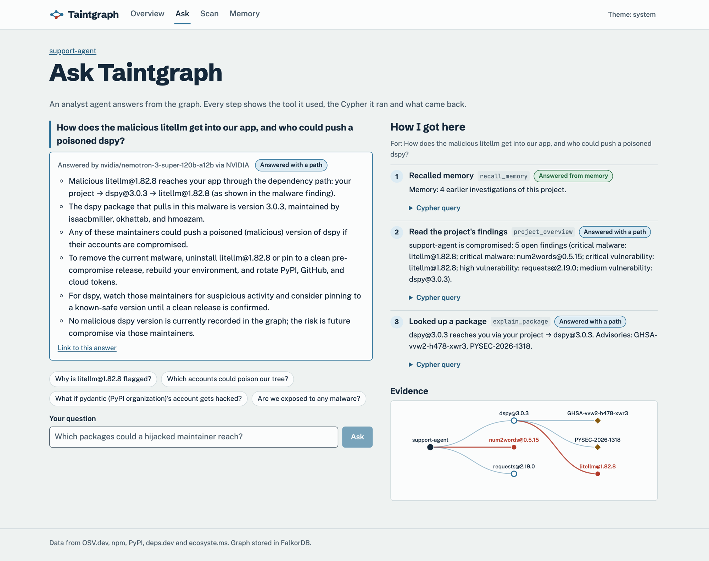

</td>
<td valign="top">

**Remembers.** Your verdicts, past investigations and learned triage rules live in the graph and change the next scan. It never skips malware automatically. Agents hand work to each other through Task nodes.

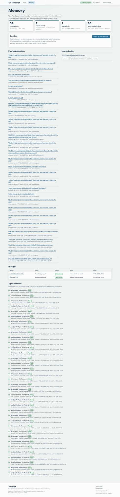

</td>
</tr>
<tr>
<td colspan="2" valign="top">

**Plans the fix.** For every compromised, tampered or high-severity version: the version to move to (the release before a malicious one, or the version that fixes every advisory), re-checked against OSV.dev so it never recommends another bad release. You get a paste-ready `overrides` block for npm, pnpm or yarn, or a `uv lock` command, plus incident-response steps when malware was installed.

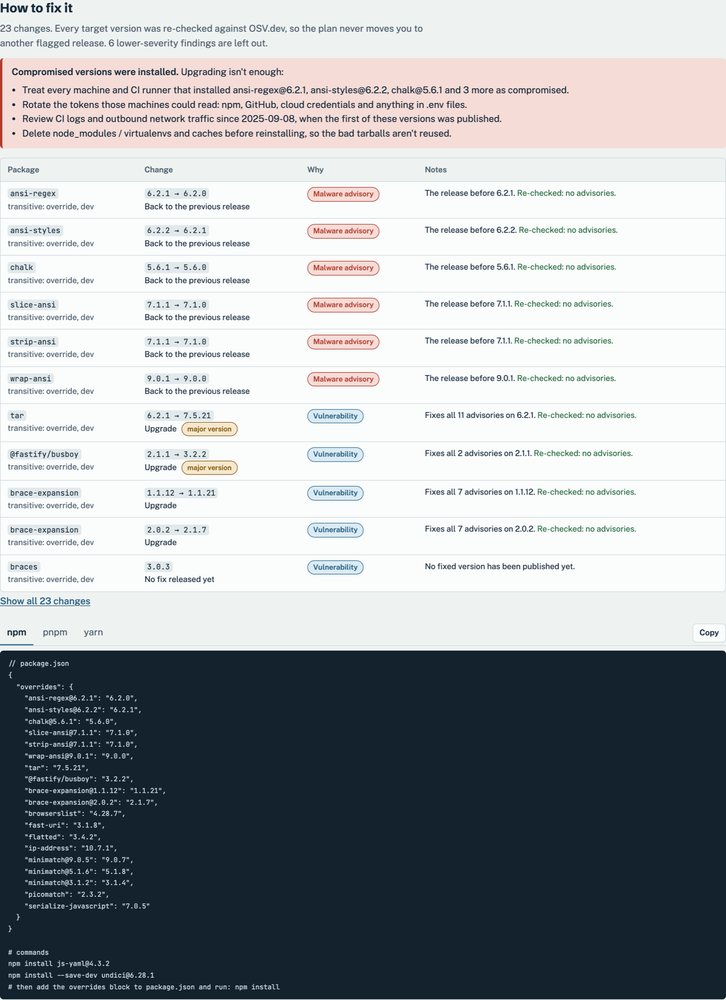

</td>
</tr>
</table>

Rescan after a lockfile update and it shows **what changed since the last scan**, and which of the new versions are flagged, which is usually how a compromise arrives.

It also flags tampered releases that no advisory covers yet:

| Signal | When |
|---|---|
| Removed from the registry | npm or PyPI no longer serves the version you pinned (registries delete malware), or npm replaced it with a security placeholder |
| Account takeover | the publisher changed **and** an install script appeared |
| Risky install script | the install hook downloads and executes, decodes base64, or reads credentials |
| Dropped provenance | the previous release had a build attestation and this one doesn't |
| Typosquat | one edit away from a top package, with a tiny fraction of its downloads |
| Unpinned MCP server | an AI tool launches `npx pkg` or `uvx pkg` with no version, so it runs whatever was published last |

## Tested on real incidents

`pnpm bench` scans the exact versions shipped in 19 real supply-chain incidents (2018 to 2026), plus 10 clean controls that include the releases just before and just after a compromise. [Full results](benchmark/RESULTS.md).

**19 of 19 incidents detected, 0 false alarms on 10 clean controls.** And Taintgraph's own lockfile scans clean: 297 versions, 0 advisories.

| Incident | Version | Detected as |
|---|---|---|
| event-stream (2018) | `flatmap-stream@0.1.1` | malware |
| ua-parser-js hijack (2021) | `ua-parser-js@0.7.29` | malware advisory (range) |
| node-ipc protestware (2022) | `node-ipc@10.1.1` | malware advisory (range) |
| @solana/web3.js key theft (2024) | `@solana/web3.js@1.95.6` | malware |
| Ultralytics cryptominer (2024) | `ultralytics==8.3.41` | malware advisory (by its wording) |
| s1ngularity, AI-CLI secret theft (2025) | `nx@21.5.0` | malware |
| chalk / debug phishing (2025) | `chalk@5.6.1`, `debug@4.4.2` | malware |
| Shai-Hulud worm (2025) | `@ctrl/tinycolor@4.1.1` | malware |
| LiteLLM credential stealer (2026) | `litellm==1.82.8` | malware |
| TanStack token hijack (2026) | `@tanstack/react-router@1.169.5` | malware |
| …and 9 more | | |

Every case is also a test: `pnpm test` fails if any incident is missed or any control is flagged.

It also scans real repositories straight from GitHub: React, Astro, Vite, LangChain, FastAPI, Flask, Bun, TypeScript and more. Every lockfile format parses, large monorepos finish in about two minutes, and only the two genuinely compromised lockfiles are called compromised. [Results](benchmark/REPOS.md).

## How it compares

Taintgraph doesn't try to out-detect commercial scanners. Socket, Snyk and Aikido analyze package contents and catch new malware before an advisory exists; Taintgraph relies on OSV.dev plus release signals. What it adds is the reasoning around a finding, for *your* project:

| | Advisory scanners<br/><sub>npm audit, pip-audit, OSV-Scanner</sub> | Org-wide SBOM graphs<br/><sub>GUAC</sub> | Taintgraph |
|---|---|---|---|
| Is a known-bad version installed? | ✅ | ✅ | ✅ |
| The route into your app, through your own lockfile edges | partial | ✅ | ✅ |
| Which maintainer accounts can publish the most of your tree | | | ✅ |
| Worm simulation from one account, wave by wave | | | ✅ |
| Release tampering without an advisory (takeover, provenance, removed) | | | ✅ |
| npm, PyPI and AI-tool MCP configs in one graph | | partial | ✅ |
| A fix plan with re-checked safe versions | `npm audit fix` | | ✅ |
| Agent that answers questions and shows its queries | | | ✅ |
| Memory of your verdicts that changes the next scan | | | ✅ |

## Quick start

You need Docker. No API key is required.

```bash
git clone https://github.com/kalash33/taintgraph && cd taintgraph
cp .env.example .env              # optional: add a Gemini, NVIDIA or OpenRouter key
docker compose up --build
```

Open http://localhost:8787 and click **chalk and debug, September 2025**: a real public lockfile caught by that attack.

<details>
<summary>Without Docker for the app (Node 24, pnpm 10)</summary>

```bash
docker compose up -d falkordb     # FalkorDB on 127.0.0.1:6380
pnpm install
pnpm build && pnpm start          # http://localhost:8787
pnpm test                         # 80 tests: unit, integration, real incidents
```
</details>

### Turn on the LLM Analyst

Without a key, a built-in investigator answers with the same tools. With one, answers read naturally and are still checked against the graph.

```bash
GEMINI_API_KEY=...                # Google AI Studio; default model gemini-3.5-flash
NVIDIA_API_KEY=nvapi-...          # build.nvidia.com; default model nvidia/nemotron-3-super-120b-a12b
OPENROUTER_API_KEY=sk-or-...      # default model openai/gpt-oss-120b
ANTHROPIC_API_KEY=sk-ant-...
LLM_PROVIDER=openai LLM_BASE_URL=http://localhost:11434/v1 LLM_MODEL=qwen3:32b   # Ollama, vLLM…
```

## Use it where you work

```bash
pnpm scan package-lock.json                                  # any lockfile or MCP config
pnpm scan https://github.com/owner/repo                      # a public repo; finds lockfiles in subfolders
pnpm scan package-lock.json --fix                            # the fix plan: safe versions + overrides
pnpm scan uv.lock --fail-on malware --sarif taintgraph.sarif   # CI gate + GitHub code scanning
pnpm scan chalk-2025 --ask "What if qix is phished?"         # ask the Analyst from the terminal
```

And as an **MCP server**, so a coding agent can check a dependency before adding it:

```json
{ "mcpServers": { "taintgraph": { "command": "pnpm", "args": ["-C", "/path/to/taintgraph/server", "mcp"] } } }
```

Supported inputs: `package-lock.json`, `pnpm-lock.yaml`, `yarn.lock` (v1 and Berry), `bun.lock`, `uv.lock`, `poetry.lock`, pinned `requirements.txt`, and MCP configs from Claude Code, Claude Desktop, Cursor and VS Code.

## How it works

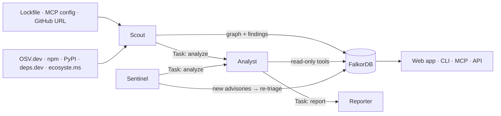

- **Scout** parses the input, pulls advisories and registry history, writes the graph, runs PageRank and triages.
- **Analyst** answers questions with fourteen fixed tools, including workspace-wide ones ("which of our projects install chalk@5.6.1, and what else can its maintainer reach?"), over `GRAPH.RO_QUERY`. It resolves names first, returns typed outcomes (`answered`, `from_memory`, `not_in_graph`, `unknown_name`) and checks its answer against the tool results.
- **Reporter** writes an incident report you can forward.
- **Sentinel** re-checks every version any project ever installed against OSV, so an advisory published today finds the app that installed the package last month.

### The graph

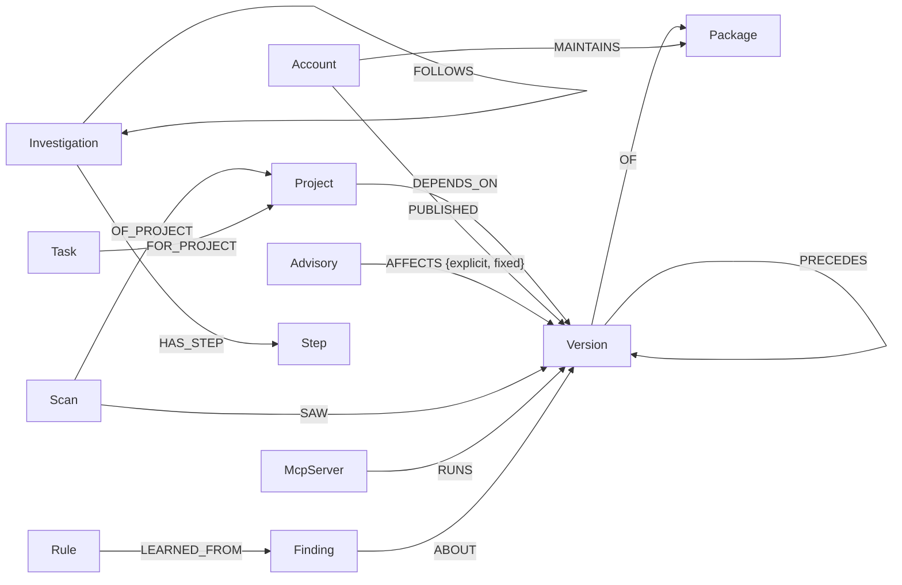

The first ten edges are the supply chain. `Finding`, `Investigation`, `Step`, `Rule` and `Task` are the agents' memory and shared state, kept in the same graph next to the facts they're about. Every property and query: [docs/graph-model.md](docs/graph-model.md).

### Where every decision comes from

Nothing the agents conclude comes from the model's own knowledge. Each answer is a graph query or algorithm, and the UI shows which one:

| Decision | How the graph makes it | Query |
|---|---|---|
| Is a malicious version installed? | `(:Advisory {kind:'malware'})-[:AFFECTS {explicit}]->(:Version)<-[:SAW]-(:Scan)` | [exposure_paths](queries/exposure_paths.cypher) |
| How does it reach the app? | `shortestPath` from the project, only over edges this project declared | [exposure_paths](queries/exposure_paths.cypher), [version_routes](queries/version_routes.cypher) |
| Was the release tampered with? | compare a version with the one it `PRECEDES`: publisher, install script, provenance | [release_facts](queries/release_facts.cypher) |
| Who could poison the tree? | `algo.pageRank` over `DEPENDS_ON`, summed over what each account can publish | [algo_pagerank](queries/algo_pagerank.cypher), [accounts_reach](queries/accounts_reach.cypher) |
| Which maintainers act as one team? | `algo.labelPropagation` over `Account-MAINTAINS-Package` | [algo_teams](queries/algo_teams.cypher) |
| How far could a worm go? | repeated hops account → version → dependents → their maintainers; `algo.WCC` bounds it | [worm_wave](queries/worm_wave.cypher), [algo_components](queries/algo_components.cypher) |
| What should we pin to? | fixed versions on `AFFECTS` edges, or the clean release that `PRECEDES` the bad one | [fix_candidates](queries/fix_candidates.cypher) |
| Which other projects are hit? | every project whose latest `Scan` `SAW` the version, and who `MAINTAINS` it | [workspace_package](queries/workspace_package.cypher), [workspace_account](queries/workspace_account.cypher) |
| Should memory skip this finding? | earlier human verdicts on the same `Version`, and active `Rule` nodes (never for malware) | [verdicts_prior](queries/verdicts_prior.cypher), [rules_active](queries/rules_active.cypher) |
| Which agent works next? | an atomic claim on an open `Task` node | [task_claim](queries/task_claim.cypher) |

All 77 Cypher queries are plain files in [`queries/`](queries). They use `shortestPath`, `allShortestPaths`, variable-length paths, `algo.pageRank`, `algo.betweenness`, `algo.labelPropagation` (community detection), `algo.WCC` (connected components), full-text search and `CALL {}` subqueries.

## Documentation

| | |
|---|---|
| [Architecture](docs/architecture.md) | components, scan flow, workspaces, code map |
| [Graph model](docs/graph-model.md) | every node and relationship, the key queries, FalkorDB notes |
| [Agents and memory](docs/agents.md) | the Analyst's tools and checks, memory, coordination, the Sentinel |
| [Usage](docs/usage.md) | web app, CLI, GitHub Actions, MCP server, HTTP API, configuration |
| [Deploying](docs/deploy.md) | Docker Compose on a VM, Railway, and what to lock down first |
| [Benchmark](benchmark/RESULTS.md) | real incidents and controls, with results |
| [Security](SECURITY.md) | how Taintgraph handles hostile package data, and how to run it safely |
| [Contributing](CONTRIBUTING.md) | setup, checks, conventions |

## More screenshots

| AI tool supply chain (dark mode) | Phone |
|---|---|
| 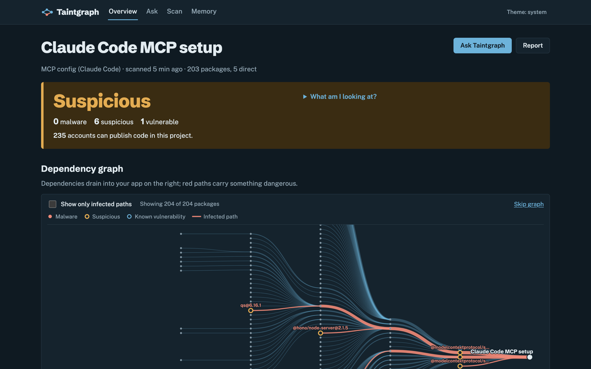 | 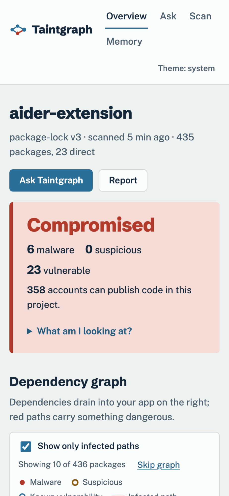 |

## Graph Hacks 2026

Built for **Graph Hacks: Context for AI Agents** (WeMakeDevs × FalkorDB), entered in:

- **Track 01: Agents That Act on Connected Data.** The Analyst answers from multi-hop paths, account reach and worm spread; the Sentinel acts on new advisories.
- **Track 02: Agent Memory and Coordination.** Verdicts, conversations, investigations and learned rules live in the graph and change future triage. Agents coordinate only through Task nodes, and claims stay exclusive under concurrency.

**AI disclosure.** Built during the event with an AI coding assistant (Claude Code). The idea and research were prepared before the event, as the rules allow; all code was written during it.

Data: [OSV.dev](https://osv.dev), the npm registry, [PyPI](https://pypi.org), [deps.dev](https://deps.dev), [ecosyste.ms](https://ecosyste.ms). Graph: [FalkorDB](https://www.falkordb.com).

## License

[MIT](LICENSE)
