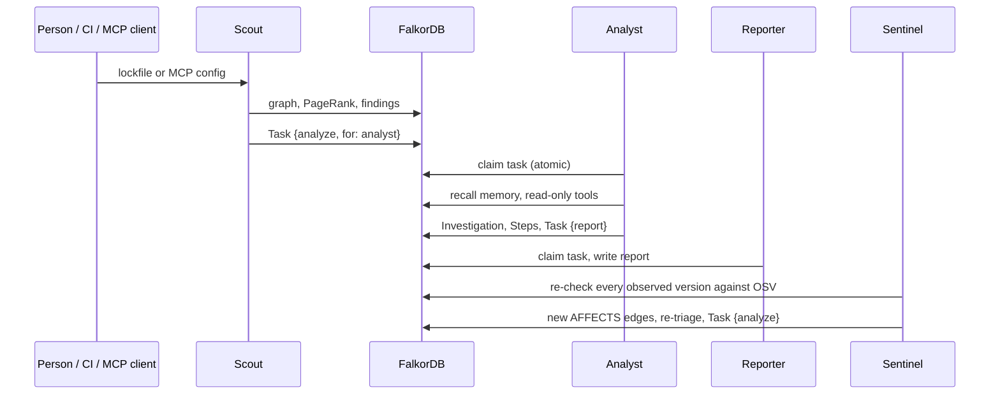

# Agents and memory

Four agents share one graph. None of them calls another: they coordinate through `Task` nodes.

| Agent | Writes | Code |
|---|---|---|
| **Scout** | the dependency graph, findings, an `analyze` task | [`ingest/scout.ts`](../server/src/ingest/scout.ts) |
| **Analyst** | investigations and steps (its tools only read) | [`agents/analyst.ts`](../server/src/agents/analyst.ts) |
| **Reporter** | the project's incident report | [`agents/reporter.ts`](../server/src/agents/reporter.ts) |
| **Sentinel** | new advisory edges, re-triaged findings, `analyze` tasks | [`agents/sentinel.ts`](../server/src/agents/sentinel.ts) |

## The Analyst

The Analyst follows the event guide on agents that reason over a graph.

**Fixed tools, never text-to-Cypher.** The model picks a tool and fills in a name. Each tool is a human-written, parameterized query run with `GRAPH.RO_QUERY`, so the agent cannot change the graph however it is prompted.

| Tool | Answers |
|---|---|
| `project_overview` | verdict and open findings with routes |
| `trace_exposures` | every advisory-hit version, malware first, with its route and the version that fixes all of its advisories |
| `explain_package` | one package: versions, routes, advisories, publishers, maintainers, install scripts, earlier verdicts |
| `workspace_exposure` | across **every** project in the workspace: which ones install a package or version (with who published and maintains it), or which ones an account can publish into |
| `scan_changes` | what changed since the previous scan: version changes, new and removed packages, and which new versions are flagged |
| `fix_plan` | the fix: a safe version for every compromised, tampered or high-severity version (re-checked on OSV.dev), overrides vs. direct upgrades, and incident steps |
| `top_accounts` | the accounts that can publish the most of the tree, by PageRank weight |
| `simulate_worm` | wave-by-wave spread from one account |
| `mcp_servers` | MCP servers, pinning, and advisories anywhere under them |
| `exposed_on` | exposure on a past date, and whether the advisory was public yet |
| `search_advisories` | full-text search over advisory summaries |
| `chokepoints` | betweenness centrality: what to pin or patch first |
| `recall_memory` | always runs first: human verdicts and earlier investigations |

**Names are resolved first.** `explain_package` and `simulate_worm` look the name up in this project before doing anything else. A typo returns `unknown_name` with the closest names by edit distance, not an empty answer.

**Typed outcomes.** Every step and every answer is one of:

| Outcome | Meaning |
|---|---|
| `answered` | a tool returned facts from the graph |
| `from_memory` | memory alone answered (the same question after the same scan) |
| `not_in_graph` | the graph has no data. This means *unknown*, never *safe*, and the model is told so |
| `unknown_name` | the package or account isn't in this project |

**Checked answers.** Before an answer is shown, every `name@version` and backticked name in it must appear in what the tools returned. If the model names something else, the answer is rebuilt from the tool summaries and marked as rebuilt; the invented name is not repeated. A cut-off answer gets the same treatment.

**Visible work.** Each step (tool, input, outcome, summary, Cypher text, evidence subgraph) is written to the graph as it happens and streamed to the UI, which draws the evidence.

### With and without a model

| | Built-in investigator | LLM |
|---|---|---|
| Picks tools by | keywords, names found in the graph, dates | function calling |
| Writes the answer | from tool summaries | in its own words, then checked |
| Needs a key | no | Gemini, OpenRouter, NVIDIA, Anthropic, or any OpenAI-compatible endpoint |

The LLM client ([`agents/llm.ts`](../server/src/agents/llm.ts)) handles what real providers do:
- retries on 429 (with Retry-After), 5xx, network errors, and 200 responses that carry an error body
- accepts tool arguments as JSON strings, objects or broken JSON
- fills in missing call ids, strips `<think>` blocks and non-breaking hyphens
- keeps OpenRouter's `reasoning_details` and Gemini's thought signatures across turns

A model that times out or fails mid-investigation hands over to the built-in investigator, which finishes from the graph.

Tested on a three-part question ("how does the malicious litellm reach us, who could push a poisoned dspy, and what should we change?"):

| Model | Tools used | Answer check | Time |
|---|---|---|---|
| `gemini-3.5-flash` (default with `GEMINI_API_KEY`) | 7 | passed | 12 s |
| `gemini-3.1-pro-preview` | 4 | passed | 31 s |
| `gemini-2.5-pro` | 4 | passed | 16 s |
| `nvidia/nemotron-3-super-120b-a12b` (default with `NVIDIA_API_KEY`) | 2 to 3 | passed | 7 s |
| `gemini-3.8-flash` | 4 | rebuilt: named a package the graph didn't return | 15 s |

## Memory

**Semantic.** A verdict (*real threat*, *not a threat*, *risk accepted*) is stored on the Finding. When another project in the workspace installs the same version, triage recalls the verdict and attaches it as a note.

**The rule that matters.** Compromise signals (`malware`, `possible_malware`, `removed`) are never skipped automatically. A person can dismiss chalk@5.6.1 in one project, and the same version in the next project still opens as a finding, with the earlier verdict as context.

**Procedural.** After two matching verdicts for a signal (say, two typosquats marked *not a threat*), a Rule is proposed: `typosquat → skip`. It does nothing until a person activates it, and rules can never target compromise signals.

**Episodic.** Investigations and their conclusions are recalled at the start of every new one. Asking the same question again after the same scan returns the earlier answer, its evidence and a link to it, with no new queries.

## Coordination

`task_claim` sets `status = 'claimed'` in a single query. FalkorDB applies writes to one graph one query at a time, so two workers can't claim the same task. Workers run every two seconds per workspace, reclaim tasks whose worker died, and give up after three attempts.

Automatic investigations triggered by scans use the built-in investigator unless `TAINTGRAPH_AUTO_LLM=1`, so scanning doesn't spend model credits.

## The Sentinel

`POST /api/sentinel` re-checks every version that any project in the workspace has installed against OSV.dev, bypassing the cache. Advisories that weren't linked before become new `AFFECTS` edges. Each project that installs an affected version is re-triaged on its latest scan and handed back to the Analyst. A malware advisory published today finds the app that installed the package last month.
