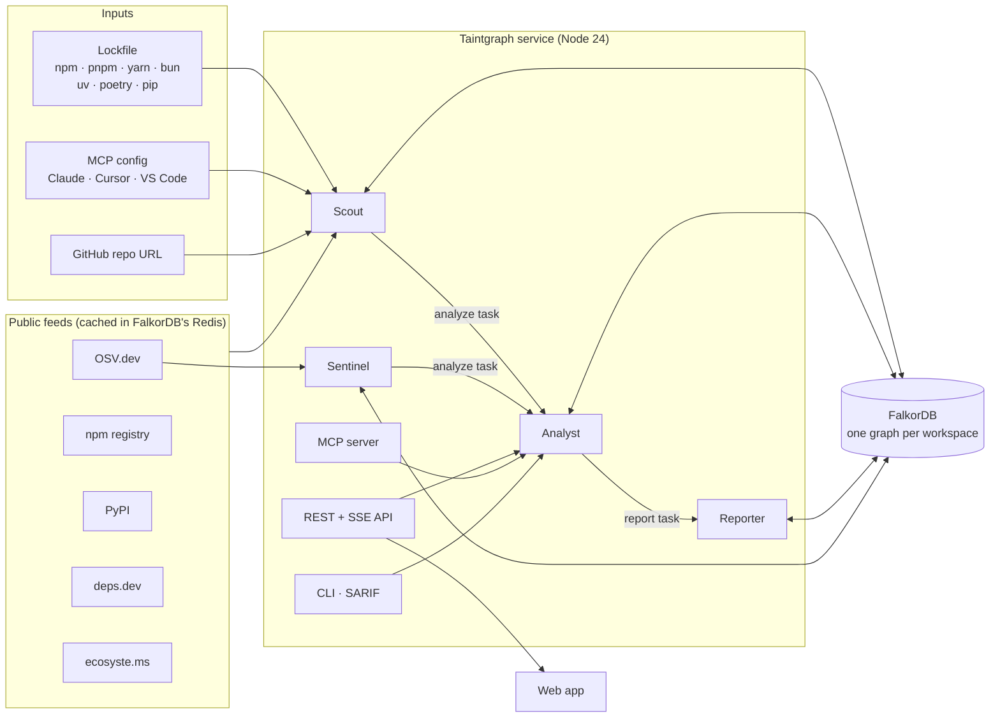

# Architecture

Taintgraph is one TypeScript service (API, agents, MCP server, CLI) and one FalkorDB instance. FalkorDB holds the graph, the agents' memory and coordination state, and a cache of every public feed response, so there is no second datastore.

## Request flow: a scan

1. **Parse.** `ingest/parsers.ts` turns the input into package versions, dependency edges (resolved the way the package manager resolves them: node_modules lookup for npm, aliases for pnpm and yarn, workspaces everywhere) and the project's direct dependencies. MCP configs become servers, and `npx`/`uvx` commands are resolved to the package they launch.
2. **Enrich.** `ingest/feeds.ts` asks OSV.dev for advisories (batched), deps.dev for publish dates, provenance and the dependencies of MCP server packages, npm and PyPI for publishers, maintainers, install scripts and release history, and ecosyste.ms for download counts. Every response is cached under `tg:cache:*` with a TTL, so a warm rescan of a 435-package lockfile takes under a second.
3. **Write.** `ingest/scout.ts` writes the graph with UNWIND batches of 500 rows, one per query file in [`queries/`](../queries).
4. **Rank.** `algo.pageRank` over `DEPENDS_ON` weights every version by how much of the graph depends on it.
5. **Triage.** `analysis.ts` turns graph facts into findings (malware, possible malware, removed release, account takeover, risky or new install script, typosquat, dropped provenance, unpinned MCP server, fresh release, vulnerability), checks memory and learned rules, and sets the project verdict.
6. **Hand off.** The Scout leaves an `analyze` Task node; the background workers pick it up.

Scans of the same project are serialized; scans of different projects run concurrently.

## Workspaces

Each workspace is a separate FalkorDB graph, `tg:org:<name>`, chosen with the `x-taintgraph-org` header (CLI: `--org`, MCP: `TAINTGRAPH_ORG`). Isolation comes from the graph boundary, not from a `WHERE` clause that a query could forget.

Inside one workspace, projects share package and version nodes (that is how a verdict in one project can inform another), but each `DEPENDS_ON` edge records which projects declared it in `projects: [ids]`. Every route query filters on it, so two projects that both install `chalk@5.6.1` never borrow each other's routes.

## Code map

| Path | What it does |
|---|---|
| `server/src/ingest/parsers.ts` | Lockfile and MCP config parsers |
| `server/src/ingest/feeds.ts` | OSV, npm, PyPI, deps.dev, ecosyste.ms clients with caching, advisory classification |
| `server/src/ingest/heuristics.ts` | Install-script patterns, typosquat distance |
| `server/src/ingest/scout.ts` | The Scout: parse → enrich → write → rank → triage → hand off |
| `server/src/analysis.ts` | Project tree, triage, accounts, worm simulation, UI graph, summaries |
| `server/src/agents/` | Analyst (`analyst.ts`, `tools.ts`, `llm.ts`), Reporter, Sentinel, task workers |
| `server/src/ingest/github.ts` | Finds a lockfile or MCP config anywhere in a public GitHub repo |
| `server/src/fix.ts` | The fix plan: safe target versions, re-checked on OSV, as overrides and commands |
| `server/src/memory.ts` | Verdicts, rule learning, the memory view |
| `server/src/index.ts` | Fastify API (REST + server-sent events) and the built web app |
| `server/src/mcp.ts` | MCP server over stdio |
| `server/src/cli.ts` | CLI with `--fail-on` and SARIF output |
| `server/src/types.ts` | The API contract, shared with the web app |
| `queries/*.cypher` | Every Cypher query, one per file |
| `web/` | Vite + React app; the dependency graph is hand-built SVG |

## Choices worth knowing

- **Queries are files.** Nothing builds Cypher from strings at runtime. The UI shows the exact query text behind every agent step.
- **Read-only agents.** Agent tools call `GRAPH.RO_QUERY`; only the Scout, triage and memory write.
- **Coordination through the graph.** Agents never call each other. They claim `Task` nodes atomically, and a task held by a crashed worker returns to the queue after ten minutes (three attempts at most).
- **No model required.** Every agent works without an LLM. A model makes the Analyst's answers more natural; it never decides what is in the graph.
