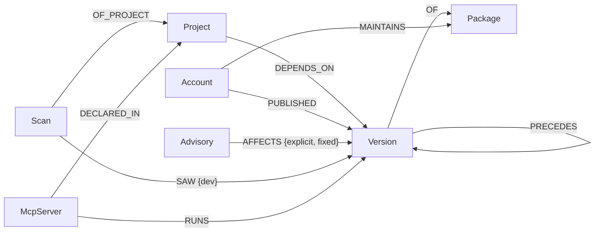
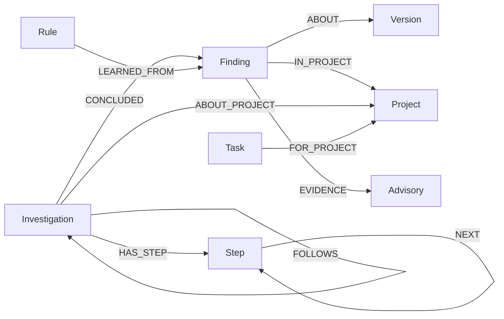

# Graph model

## Nodes

| Label | Key | Notable properties |
|---|---|---|
| `Project` | `project/<id>` | `name`, `kind` (app or agent-config), `source` (lockfile type), `latest_scan`, `verdict`, `report` |
| `Scan` | `scan-<id>` | `at`. A snapshot: what the project installed at that moment |
| `Version` | `npm/chalk@5.6.1`, `pypi/litellm@1.82.8` | `published_at`, `has_install_script`, `install_scripts`, `has_provenance`, `removed`, `rank` (PageRank) |
| `Package` | `npm/chalk` | `downloads`, `dependents`, `typosquat_of` |
| `Account` | `npm-user/qix`, `pypi-user/x`, `pypi-org/y`, `workflow/npm:<pkg>` | `login`, `kind` (user, org, workflow) |
| `Advisory` | `MAL-2025-46969`, `GHSA-…`, `PYSEC-…` | `kind` (malware or vuln), `severity`, `summary` (full-text indexed), `published` |
| `McpServer` | `mcp/<project>/<name>` | `client`, `command`, `pinned` |

## Relationships

| Relationship | Meaning |
|---|---|
| `(Project)-[:DEPENDS_ON {dev}]->(Version)` | a direct dependency |
| `(Version)-[:DEPENDS_ON {projects}]->(Version)` | a resolved dependency; `projects` lists the projects whose lockfile declared this edge |
| `(Version)-[:OF]->(Package)` | version of a package |
| `(Version)-[:PRECEDES]->(Version)` | previous stable release → this one, used to spot publisher, install-script and provenance changes |
| `(Account)-[:MAINTAINS]->(Package)` | can publish new versions |
| `(Account)-[:PUBLISHED]->(Version)` | actually pushed this release (a trusted-publishing CI identity is a `workflow` account) |
| `(Advisory)-[:AFFECTS {explicit, fixed, first_seen}]->(Version)` | `explicit` is true when the advisory lists the version by name, not just by range; `first_seen` tells the Sentinel what is new |
| `(Scan)-[:SAW {dev}]->(Version)` | the version was installed at scan time |
| `(McpServer)-[:RUNS]->(Version)` | the package an MCP server launches |

## Memory and coordination

| Label | Properties |
|---|---|
| `Finding` | `signal`, `severity`, `title`, `path` (route from the project), `status` (open, confirmed, dismissed, accepted, skipped), `status_note` |
| `Investigation` | `question`, `agent`, `answer`, `outcome`, `validated` |
| `Step` | `tool`, `input`, `outcome`, `summary`, `cypher`, `evidence` |
| `Rule` | `when` (a signal), `then` (escalate or skip), `status` (proposed or active), `confidence` |
| `Task` | `type` (analyze or report), `for_agent`, `status`, `claimed_by`, `attempts` |

Memory lives next to the facts it is about. A human verdict is a property of a `Finding` that points at a `Version`, so the next project that installs the same version finds it with one hop.

## Why a graph

The questions are paths:

- *How does this reach me?* Project → lint-staged → listr2 → log-update → strip-ansi → ansi-regex@6.2.1 ← MAL-2025-46966.
- *Who could poison it?* ansi-regex → Package ← MAINTAINS ← qix → MAINTAINS → 15 more packages in the same tree.
- *What would a worm do?* Repeat the previous hop: poisoned versions → the maintainers of everything that depends on them → what they maintain.

In a relational store each of these is a recursive join whose depth you don't know in advance. In FalkorDB they are `shortestPath`, `allShortestPaths` and a variable-length `DEPENDS_ON*` pattern.

## Queries

All 77 queries live in [`queries/`](../queries), one per file, loaded by name. Highlights:

| Query | Technique |
|---|---|
| [`exposure_paths`](../queries/exposure_paths.cypher) | `shortestPath` from the project to every advisory-hit version, and whether that route uses only this project's edges |
| [`version_routes`](../queries/version_routes.cypher) | `allShortestPaths`, filtered with `all(r IN relationships(route) WHERE …)` |
| [`algo_pagerank`](../queries/algo_pagerank.cypher) | `algo.pageRank('Version', 'DEPENDS_ON')` |
| [`algo_chokepoints`](../queries/algo_chokepoints.cypher) | `algo.betweenness` over versions |
| [`algo_teams`](../queries/algo_teams.cypher) | `algo.labelPropagation` (community detection) over Account-MAINTAINS-Package: maintainer teams |
| [`algo_components`](../queries/algo_components.cypher) | `algo.WCC` (connected components): the largest network a worm could travel |
| [`accounts_reach`](../queries/accounts_reach.cypher) | `CALL { … UNION … }` of maintainers and publishers, weighted by PageRank |
| [`worm_wave`](../queries/worm_wave.cypher) | one wave of worm spread, per project |
| [`release_facts`](../queries/release_facts.cypher) | compare a release with the one it `PRECEDES` |
| [`mcp_exposure`](../queries/mcp_exposure.cypher) | variable-length `DEPENDS_ON*0..6` from an MCP server to any advisory |
| [`point_in_time`](../queries/point_in_time.cypher) | latest scan on or before a date, and whether the advisory was public then |
| [`advisories_search`](../queries/advisories_search.cypher) | `db.idx.fulltext.queryNodes` over advisory summaries |
| [`task_claim`](../queries/task_claim.cypher) | atomic task claim between agents |
| [`investigation_step`](../queries/investigation_step.cypher) | append a step and link it to the previous one |

Indexes and constraints are created by [`server/src/schema.ts`](../server/src/schema.ts): range indexes on every key, a full-text index on `Advisory.summary`, and unique constraints on node keys.

## FalkorDB notes

Tested on FalkorDB v4.22.1 (pinned in `docker-compose.yml` and CI) and on the 6.x `edge-rs` build. Things we hit and how the queries deal with them:

- `shortestPath` is only allowed in `WITH` or `RETURN`, so it is computed there and filtered afterwards.
- Repeating the same anonymous pattern, e.g. `(:Scan {id: $scanId})` twice, can return nothing. Bind it once and reuse the variable.
- After `UNWIND`, a `WHERE` on an `OPTIONAL MATCH` can drop every row. Those filters are `CASE` expressions after the match.
- `algo.pageRank` fails on a graph with no matching edges, so the Scout checks for version-to-version edges first.
- On 4.x, a query parameter named `cypher` breaks the `CYPHER name=value` header, so the step query uses `$queryText`.
